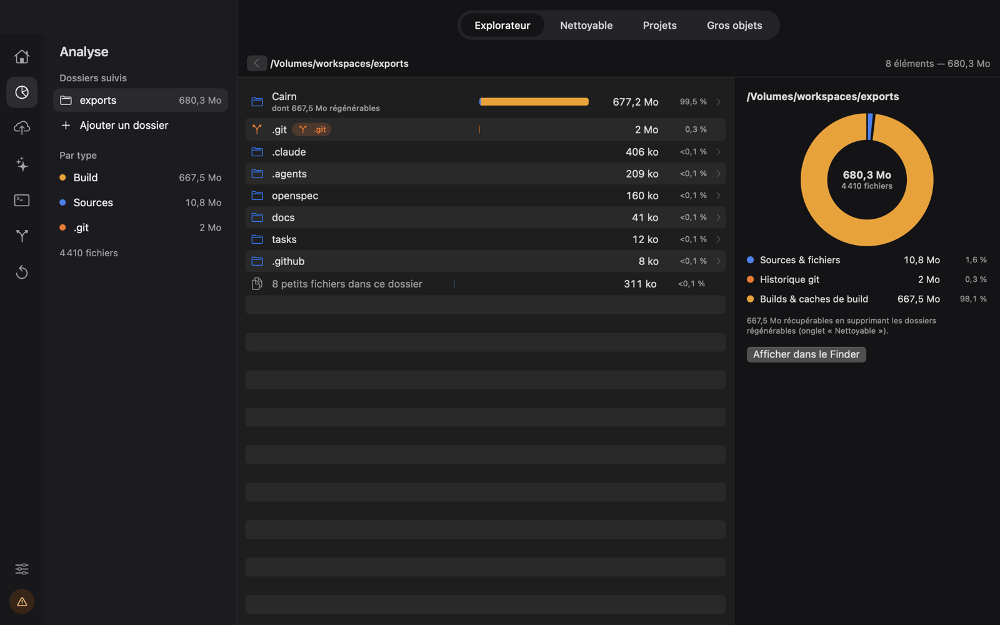
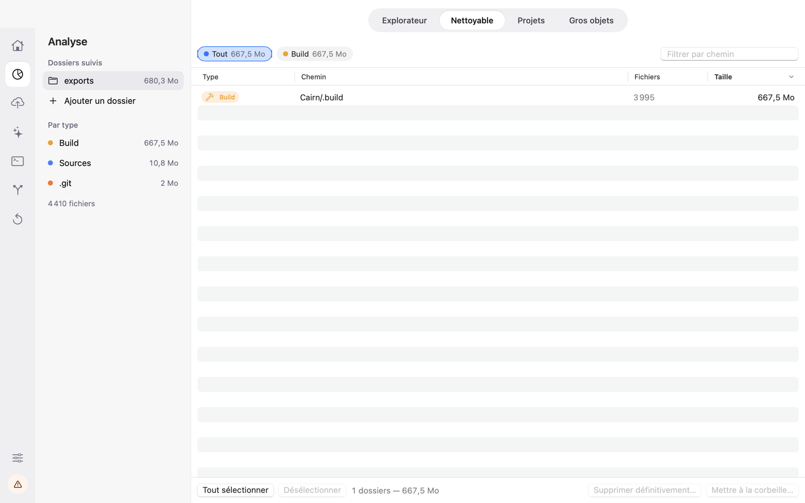
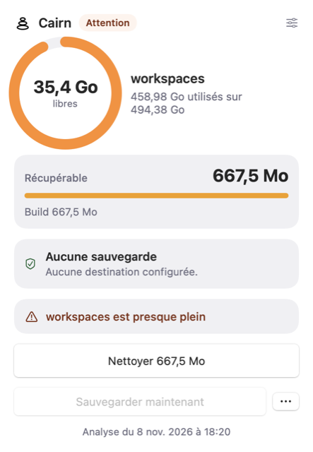
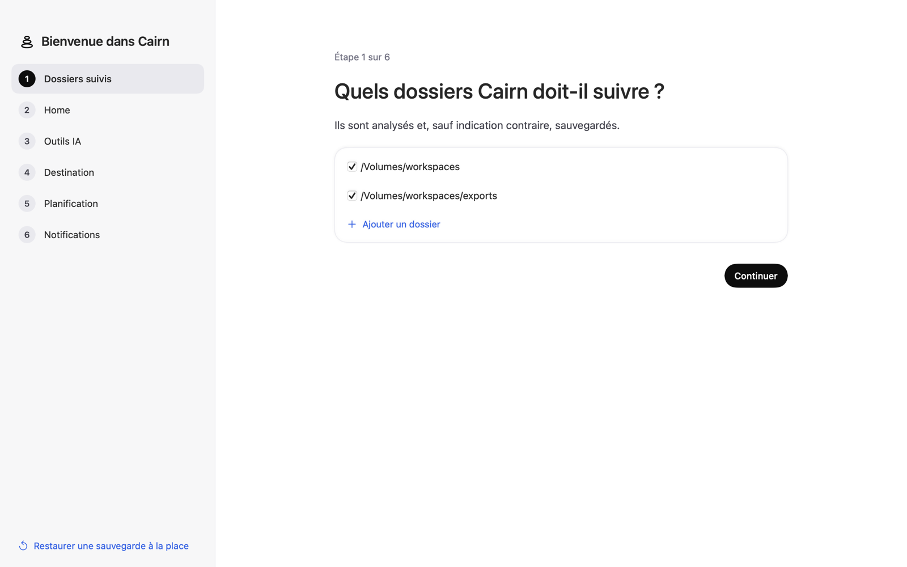

<p align="center">
  
</p>

<h1 align="center">Cairn</h1>

<p align="center"><a href="README.md">English</a> · <strong>Français</strong></p>

<p align="center">
  <strong>Comprendre, sauvegarder et redéployer son Mac de développeur.</strong><br>
  Une app macOS et une commande <code>cairn</code> pour analyser le disque, sauvegarder ce qui compte,
  nettoyer les dépôts git et tout restaurer sur un autre Mac.
</p>

<p align="center">
  <a href="https://github.com/Romakita/cairn/actions/workflows/ci.yml"></a>
  <a href="https://github.com/Romakita/cairn/releases"></a>
  
  
  
  <a href="LICENSE"></a>
</p>

<p align="center">
  
</p>

---

## Pourquoi Cairn ?

Un poste de développeur accumule vite des dizaines de gigaoctets : `node_modules`, `DerivedData`, `.venv`, worktrees
oubliés, branches fusionnées depuis des mois… Et le jour où il faut changer de Mac, on se rend compte que ce qui compte
vraiment est éparpillé : dotfiles, clés SSH, conversations avec les assistants IA, liste des outils installés.

Time Machine sauvegarde tout, y compris ce qui se régénère en une commande. Les scripts maison finissent par diverger.
Cairn part d'une idée simple : **séparer ce qui est précieux de ce qui est régénérable**, et appliquer cette même règle
partout — à l'analyse, à la sauvegarde, au nettoyage et à la restauration.

Comme un cairn sur un sentier, il marque le chemin pour retrouver son environnement intact.

**Principes :**

- **Rien d'irréversible sans votre accord.** L'analyse ne modifie jamais le disque. Les suppressions passent par la
  corbeille par défaut, après confirmation. Le nettoyage git et la restauration sont en simulation tant qu'on ne passe
  pas `--apply`.
- **Vos secrets restent les vôtres.** Sauvegardes chiffrées (AES-256) par défaut, mots de passe dans le Trousseau
  macOS, jamais dans un fichier.
- **Un seul binaire.** L'app et la commande `cairn` partagent le même moteur : tout ce que fait l'interface est
  scriptable.
- **Configuration lisible.** Un fichier TOML commenté (`~/.cairn/config.toml`), modifiable à la main ou depuis l'app.

## Fonctionnalités

<table>
<tr>
<td width="50%"></td>
<td width="50%"></td>
</tr>
<tr>
<td align="center"><em>Explorateur : répartition sources / historique git / builds</em></td>
<td align="center"><em>Nettoyable : dossiers régénérables, envoyés à la corbeille après confirmation</em></td>
</tr>
</table>

### 🔍 Analyse du stockage
- Explorateur des dossiers suivis, avec répartition par type (sources, historique git, builds et caches).
- Repérage du contenu **régénérable** (`node_modules`, `dist`, `.build`, `DerivedData`, `Pods`, `.venv`, `target`…) ;
  les dossiers génériques (`lib/`, `build/`, `vendor/`) ne sont comptés que s'ils sont vraiment générés.
- Gros projets (worktrees compris) et gros fichiers.

### 💾 Sauvegardes versionnées
- Vers un dossier, un disque externe ou un NAS en SMB, via `rsync --link-dest` (les fichiers inchangés ne prennent
  pas de place).
- Image disque chiffrée AES-256 par défaut, rétention par paliers (30 jours en quotidien, puis hebdomadaire),
  reprise d'une sauvegarde interrompue, contrôle d'intégrité SHA-256.
- Planification, attente d'un NAS injoignable, seuil de batterie.

### 🤖 Outils IA
- Sauvegarde et restauration des conversations, de la configuration et des mémoires de **Claude Code**,
  **Claude Desktop** et **Codex**, avec des copies cohérentes des bases SQLite.
- Chaque outil est décrit par un profil JSON déclaratif : en ajouter un ne demande aucun changement du moteur.

### 🧰 Inventaire des outils CLI
- Liste ce qui est installé par Homebrew, mise, npm, uv, pipx, cargo et go, et indique ce qui est réellement utilisé
  (configuration dans le home, fichiers de projet, historique du shell).
- Export d'un `tools.toml` et d'un `Brewfile` pour tout réinstaller.

### 🌿 Maintenance git
- Branches « gone », fusionnées ou squashées, worktrees obsolètes, `git gc`.
- Simulation par défaut ; un worktree avec du travail non commité ou non poussé n'est jamais supprimé.
- Les SHA supprimés sont journalisés : une branche se recrée tant que l'espace n'a pas été libéré.

### ♻️ Restauration
- Restauration sélective (home, dossiers, outils IA, outils CLI), y compris sur un Mac neuf.
- Les fichiers remplacés sont gardés avec le suffixe `.pre-restore` ; les conversations IA sont fusionnées.
- Restauration d'un dossier à un autre emplacement, avec réécriture des chemins de Claude Code.

### 📊 Barre des menus et alertes



- Jauge de chaque volume, espace récupérable et état des sauvegardes, sans relancer d'analyse.
- Alertes de disque presque plein, critique, ou plein dans moins de 7 jours au rythme actuel.
- Interface en **français** et en **anglais**.

<br clear="right">

## Installation

**Prérequis :** macOS 14 Sonoma ou plus récent.

### Depuis une release

1. Télécharger `Cairn-<version>-arm64.zip` depuis la page [Releases](https://github.com/Romakita/cairn/releases)
   (une empreinte `.sha256` est fournie).
2. Décompresser et glisser `Cairn.app` dans `~/Applications`.
3. L'app n'est pas encore signée avec un Developer ID ni notarisée : au premier lancement, clic droit → **Ouvrir**, ou

   ```bash
   xattr -dr com.apple.quarantine ~/Applications/Cairn.app
   ```

4. Optionnel, pour la commande `cairn` :

   ```bash
   ln -sf ~/Applications/Cairn.app/Contents/MacOS/Cairn ~/.local/bin/cairn
   ```

Les versions suivantes s'installent depuis l'app : quand une release sort, un bouton **Mise à jour disponible**
apparaît en bas de la barre d'icônes (ou **Cairn → Rechercher les mises à jour…**). Le contrôle automatique se coupe
avec `[updates] check = false` dans `config.toml`.

### Depuis les sources

Il faut les [Command Line Tools](https://developer.apple.com/xcode/resources/) (`xcode-select --install`, pour le
module natif ; Xcode n'est pas nécessaire), [Bun](https://bun.sh) 1.4.4 et [just](https://github.com/casey/just).

```bash
git clone https://github.com/Romakita/cairn.git
cd cairn
just storage-install   # bun install + bun run dist, installe Cairn.app dans ~/Applications et relie ~/.local/bin/cairn
just storage           # ouvre l'app
```

Pour travailler sur l'app sans l'installer : `just dev` (app Electron), `just dev-web` (interface dans le navigateur
avec des données d'exemple) et `cd desktop && bun run cli <commande>` (la commande `cairn`). Voir
[desktop/README.md](desktop/README.md).

Au premier lancement, un assistant en six étapes configure les dossiers suivis, les éléments du home, les outils IA, la
destination, la planification et les notifications. On peut aussi choisir **« Restaurer une sauvegarde à la place »**.

<p align="center">
  
</p>

## Utilisation

Tout ce que fait l'app est disponible en ligne de commande. Depuis la racine du dépôt, `just` liste les raccourcis :

| Commande | Rôle |
|---|---|
| `just storage-report` | occupation disque dans le terminal |
| `just backup` / `just backup-dry` | sauvegarde vers les destinations configurées / simulation |
| `just restore …` | restaure une sauvegarde (simulation sans `--apply`) |
| `just check` | vérifie seulement les outils requis listés dans la sauvegarde |
| `just verify` | contrôle d'intégrité des sauvegardes (`--full` : tout) |
| `just git-clean` / `just git-clean-apply` | nettoyage git : simulation / application |
| `just tools` | outils CLI à réinstaller (`--export DOSSIER`) |

Les options passent à la suite : `just backup --destination nas --only home`.

Quelques exemples avec la commande `cairn` :

```bash
cairn analyze ~/workspaces --json          # analyse d'un dossier, sortie JSON
cairn backup --dry-run                     # ce qui serait sauvegardé, sans rien écrire
cairn git --fetch                          # branches et worktrees à nettoyer (simulation)
cairn git --apply --prune-now              # nettoyage après confirmation, espace libéré tout de suite
cairn restore --destination nas            # simulation de la restauration de la dernière version
cairn restore --destination nas --apply    # restauration réelle
cairn config validate                      # vérifie ~/.cairn/config.toml
```

Codes de sortie : `0` succès, `1` échec, `2` erreur d'usage ou de configuration. `--lang en-US|fr-FR` force la
langue, `--config <fichier>` utilise un autre fichier de configuration. Référence complète des commandes :
[docs/reference.md](docs/reference.md).

## Configuration

La configuration vit dans `~/.cairn/config.toml`. Elle est créée par l'assistant et reste modifiable à la main :
l'app la recharge, conserve les commentaires et les clés inconnues. Exemple complet et commenté :
[`desktop/resources/config.example.toml`](desktop/resources/config.example.toml). Référence de toutes les clés :
[docs/reference.md](docs/reference.md#configuration--cairnconfigtoml).

```toml
[[folders]]
path = "/Volumes/workspaces"
backup = true

[[destinations]]
id = "nas"
provider = "smb"
url = "smb://nas.local/backups"
encrypted = true
retention = { mode = "tiered", days = 30, weeks = 48 }

[schedule]
frequency = "daily"
time = "12:30"
```

## Tests

Les tests unitaires passent par `bun test`, les tests de bout en bout pilotent la vraie app Electron avec
[Playwright](https://playwright.dev). Xcode n'est pas nécessaire ; construire une fois le module natif avec
`cd desktop && bun run build:native` (sinon les tests qui en dépendent sont sautés).

```bash
just test              # core et CLI (bun test)
just test Inventory    # seulement les tests dont le nom correspond à « Inventory »
just e2e               # tests de bout en bout sur la vraie app (Playwright)
just lint              # Biome, règles du design system et vérification des types
```

Pour vérifier un changement de bout en bout, les modes simulation n'écrivent rien :

```bash
just backup-dry
just git-clean
just restore
just storage-report    # totaux à comparer à `du -sk <dossier>`
```

Le workflow **CI** lance le lint, les tests unitaires et de bout en bout, puis construit et teste l'archive de l'app à
chaque push sur `main` et chaque pull request.

## Architecture

Cairn est une app [Electron](https://www.electronjs.org) écrite en TypeScript ; [Bun](https://bun.sh) l'installe, la
construit et la teste, et l'app tourne sur le Node d'Electron.

```text
desktop/
├── src/
│   ├── core/       # logique sans interface : analyse, sauvegarde, restauration, git, config, inventaire (API node:*)
│   ├── cli/        # commandes `cairn`, au-dessus du core (même exécutable que l'app)
│   ├── main/       # process principal Electron : fenêtres, barre des menus, IPC, planificateur, notifications, mises à jour
│   ├── preload/    # API typée exposée à l'interface
│   ├── renderer/   # interface React : composants (ui/), écrans, galerie des composants, jetons de design
│   └── shared/     # contrat entre le process principal et l'interface
├── native/         # module N-API (Objective-C) : Trousseau, montage SMB, flock, espace libre APFS
├── resources/      # profils des outils IA, règles d'inventaire, icônes de la barre des menus, config d'exemple
├── locales/        # traductions (en, fr)
├── test/           # bun test (core, régressions) et Playwright (e2e)
└── scripts/        # build, empaquetage, installation, captures, release
docs/               # référence et images
openspec/           # specs du comportement et changements proposés
```

- Le core ne dépend ni d'Electron ni de React : toute la logique est testable en ligne de commande.
- Les analyses git lourdes passent par un pool de workers, sans jamais charger un historique entier en mémoire.
- Les règles de « régénérable » sont communes à l'analyse et à la sauvegarde.
- Guide de développement et règles du code : [desktop/README.md](desktop/README.md) ; design system :
  [desktop/DESIGN.md](desktop/DESIGN.md).

Cairn était une app Swift (SwiftUI) jusqu'à la version 0.8.0 ; ses sources sont dans l'historique git (tag `v0.8.0`).

## Contribuer

Les contributions sont les bienvenues : rapports de bug, nouveaux profils d'outils IA, règles d'inventaire,
traductions…

1. Ouvrir une issue pour discuter d'un changement de comportement avant de coder.
2. Les nouvelles fonctionnalités passent par [OpenSpec](https://github.com/Fission-AI/OpenSpec) : proposition, design,
   specs et tâches dans `openspec/changes/` (voir [AGENTS.md](AGENTS.md)).
3. Tout texte visible passe par `t("clé")` avec une entrée en anglais **et** en français (`desktop/locales/`) ; un
   test le vérifie.
4. Toute opération destructive doit rester explicite, confirmée et disposer d'un mode simulation.
5. `just test`, `just lint` et `just e2e` doivent passer. Ne pas modifier [CHANGELOG.md](CHANGELOG.md) : il est généré
   à partir des sujets des commits `feat` / `fix`, à rédiger comme des lignes de note de release.

Ajouter un outil IA = ajouter un profil JSON dans `desktop/resources/ai-tools/`. Ajouter une règle d'inventaire =
éditer `desktop/resources/rules/rules.json`. Détails dans [docs/reference.md](docs/reference.md).

## Versions et releases

La version suit [SemVer](https://semver.org/lang/fr/) et vit dans `desktop/package.json` (`just version`,
`cairn --version`).

Les releases sont publiées par la CI avec [semantic-release](https://semantic-release.gitbook.io/) : branche → PR →
revue → merge sur `main` → build → release. La version découle des
[Conventional Commits](https://www.conventionalcommits.org/fr/) mergés depuis le dernier tag :

| Commits depuis la dernière release | Version suivante |
|---|---|
| un breaking change (`feat!: …`, ou `BREAKING CHANGE:` dans le corps) | majeure (`0.2.3` → `1.0.0`) |
| un `feat` | mineure (`0.2.3` → `0.3.0`) |
| seulement des `fix` / `perf` | patch (`0.2.3` → `0.2.4`) |
| seulement `docs`, `ci`, `chore`, `refactor`, `test`… | pas de release |

Une fois le build de `main` passé, la CI met à jour la version dans `desktop/package.json` et `CHANGELOG.md`
(nouvelle section datée de la version), lance les tests, construit et teste l'archive, pousse un commit
`chore(release): X.Y.Z` sur `main`, le tague `vX.Y.Z` et publie une release GitHub avec `Cairn-<version>-arm64.zip` et
son empreinte SHA-256 (`just release-build` construit la même archive en local, dans `desktop/release/`). Les notes de
release, dans le CHANGELOG et sur GitHub, sont générées à partir des sujets des commits (`feat` → Added, `fix` /
`perf` → Fixed, breaking → Changed). Configuration : [.releaserc.json](.releaserc.json).

## Feuille de route

- Signature Developer ID et notarisation.
- Build universel (Intel + Apple Silicon).
- Nouveaux profils d'outils IA et nouvelles destinations.

## Licence

Distribué sous licence [MIT](LICENSE).
