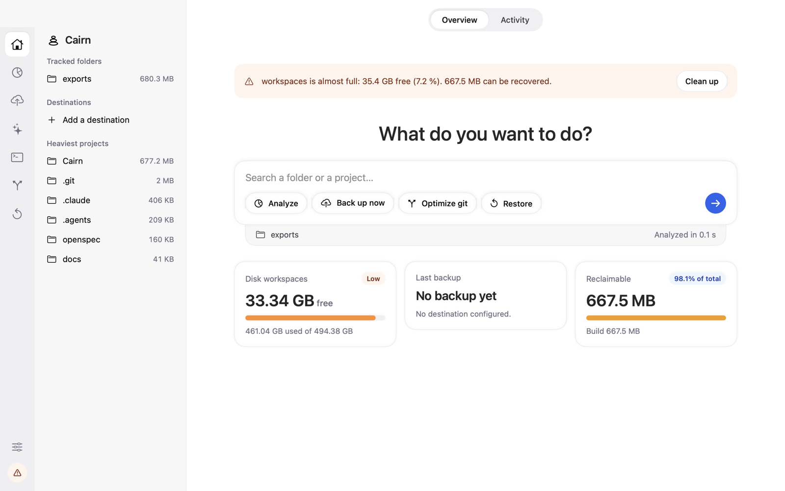
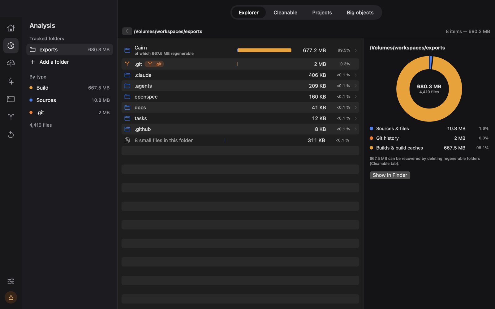
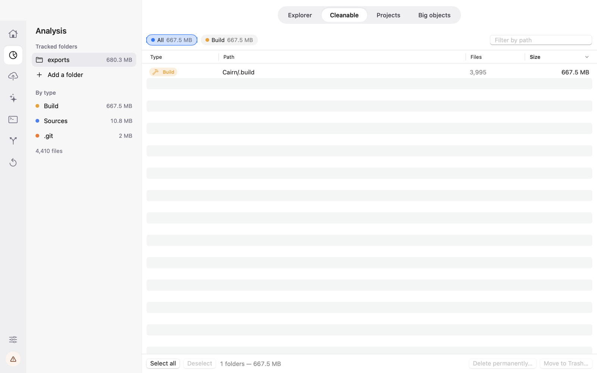
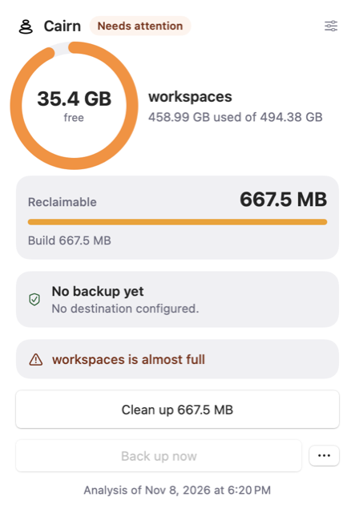
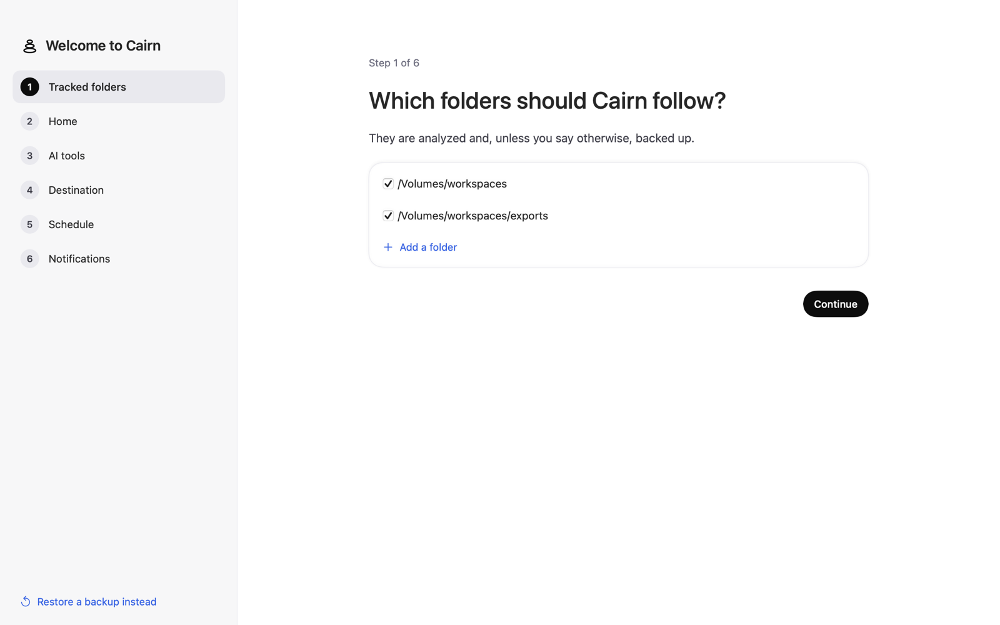

<p align="center">
  
</p>

<h1 align="center">Cairn</h1>

<p align="center"><strong>English</strong> · <a href="README.fr.md">Français</a></p>

<p align="center">
  <strong>Understand, back up and redeploy your developer Mac.</strong><br>
  A macOS app and a <code>cairn</code> command to analyze disk usage, back up what matters,
  clean up git repositories and restore everything on another Mac.
</p>

<p align="center">
  <a href="https://github.com/Romakita/cairn/actions/workflows/ci.yml"></a>
  <a href="https://github.com/Romakita/cairn/releases"></a>
  
  
  
  <a href="LICENSE"></a>
</p>

<p align="center">
  
</p>

---

## Why Cairn?

A developer machine quickly piles up tens of gigabytes: `node_modules`, `DerivedData`, `.venv`, forgotten worktrees,
branches merged months ago… And when it's time to move to a new Mac, what really matters turns out to be scattered
everywhere: dotfiles, SSH keys, conversations with AI assistants, the list of installed tools.

Time Machine backs up everything, including what one command can regenerate. Home-made scripts drift apart over time.
Cairn starts from a simple idea: **separate what is precious from what is regenerable**, and apply that same rule
everywhere — analysis, backup, cleanup and restore.

Like a cairn on a trail, it marks the way back to your environment, intact.

**Principles:**

- **Nothing irreversible without your consent.** Analysis never modifies the disk. Deletions go to the Trash by
  default, after confirmation. Git cleanup and restore run as a dry run until you pass `--apply`.
- **Your secrets stay yours.** Backups are encrypted (AES-256) by default, passwords live in the macOS Keychain, never
  in a file.
- **One binary.** The SwiftUI app and the `cairn` command share the same engine: everything the UI does is scriptable.
- **Readable configuration.** A commented TOML file (`~/.cairn/config.toml`), editable by hand or from the app.

## Features

<table>
<tr>
<td width="50%"></td>
<td width="50%"></td>
</tr>
<tr>
<td align="center"><em>Explorer: sources / git history / builds breakdown</em></td>
<td align="center"><em>Cleanable: regenerable folders, moved to the Trash after confirmation</em></td>
</tr>
</table>

### 🔍 Storage analysis
- Explorer for tracked folders, with a breakdown by type (sources, git history, builds and caches).
- Detection of **regenerable** content (`node_modules`, `dist`, `.build`, `DerivedData`, `Pods`, `.venv`, `target`…);
  generic folders (`lib/`, `build/`, `vendor/`) only count when they are actually generated.
- Largest projects (worktrees included) and largest files.

### 💾 Versioned backups
- To a folder, an external drive or an SMB NAS, using `rsync --link-dest` (unchanged files take no extra space).
- AES-256 encrypted disk image by default, tiered retention (daily for 30 days, then weekly), resume after an
  interruption, SHA-256 integrity checks.
- Scheduling, waits for an unreachable NAS, minimum battery level.

### 🤖 AI tools
- Backs up and restores conversations, configuration and memories of **Claude Code**, **Claude Desktop** and
  **Codex**, with consistent copies of SQLite databases.
- Each tool is described by a declarative JSON profile: adding one requires no engine change.

### 🧰 CLI tools inventory
- Lists what Homebrew, mise, npm, uv, pipx, cargo and go installed, and flags what you actually use (config in your
  home folder, project files, shell history).
- Exports a `tools.toml` and a `Brewfile` to reinstall everything.

### 🌿 Git maintenance
- "Gone", merged or squash-merged branches, stale worktrees, `git gc`.
- Dry run by default; a worktree with uncommitted or unpushed work is never removed.
- Deleted SHAs are logged: a branch can be recreated as long as the space hasn't been reclaimed.

### ♻️ Restore
- Selective restore (home, folders, AI tools, CLI tools), including on a brand-new Mac.
- Replaced files are kept with a `.pre-restore` suffix; AI conversations are merged.
- Restore a folder to another location, with Claude Code paths rewritten.

### 📊 Menu bar and alerts



- Gauge for each volume, reclaimable space and backup status, without re-running an analysis.
- Alerts when a disk is almost full, critical, or will be full within 7 days at the current rate.
- UI in **English** and **French**.

<br clear="right">

## Installation

**Requirements:** macOS 14 Sonoma or later.

### From a release

1. Download `Cairn-<version>-arm64.zip` from the [Releases](https://github.com/Romakita/cairn/releases) page
   (a `.sha256` checksum is provided).
2. Unzip it and drag `Cairn.app` into `~/Applications`.
3. The app is not yet signed with a Developer ID nor notarized: on first launch, right-click → **Open**, or

   ```bash
   xattr -dr com.apple.quarantine ~/Applications/Cairn.app
   ```

4. Optional, for the `cairn` command:

   ```bash
   ln -sf ~/Applications/Cairn.app/Contents/MacOS/Cairn ~/.local/bin/cairn
   ```

Later versions install from the app itself: when a new release is out, an **Update available** button
appears at the bottom of the icon bar (or use **Cairn → Check for Updates…**). Turn off the automatic check with
`[updates] check = false` in `config.toml`.

### From source

You need the [Command Line Tools](https://developer.apple.com/xcode/resources/) (Xcode is not required) and
[just](https://github.com/casey/just).

```bash
git clone https://github.com/Romakita/cairn.git
cd cairn
just storage-install   # builds Cairn.app, installs it in ~/Applications and links ~/.local/bin/cairn
just storage           # opens the app
```

On first launch, a six-step assistant sets up tracked folders, home items, AI tools, the destination, the schedule and
notifications. You can also pick **"Restore a backup instead"**.

<p align="center">
  
</p>

## Usage

Everything the app does is available from the command line. From the repository root, `just` lists the shortcuts:

| Command | What it does |
|---|---|
| `just storage-report` | disk usage in the terminal |
| `just backup` / `just backup-dry` | back up to the configured destinations / dry run |
| `just restore …` | restore a backup (dry run without `--apply`) |
| `just check` | only check the required tools listed in the backup |
| `just verify` | backup integrity check (`--full`: everything) |
| `just git-clean` / `just git-clean-apply` | git cleanup: dry run / apply |
| `just tools` | CLI tools to reinstall (`--export DIR`) |

Options are passed through: `just backup --destination nas --only home`.

A few examples with the `cairn` command:

```bash
cairn analyze ~/workspaces --json          # analyze a folder, JSON output
cairn backup --dry-run                     # what would be backed up, without writing anything
cairn git --fetch                          # branches and worktrees to clean up (dry run)
cairn git --apply --prune-now              # clean up after confirmation, space reclaimed right away
cairn restore --destination nas            # dry run of restoring the latest version
cairn restore --destination nas --apply    # actual restore
cairn config validate                      # check ~/.cairn/config.toml
```

Exit codes: `0` success, `1` failure, `2` usage or configuration error. Use `--lang en-US|fr-FR` to force the language.

## Configuration

Configuration lives in `~/.cairn/config.toml`. The assistant creates it and it stays editable by hand: the app reloads
it and keeps comments and unknown keys. Full commented example:
[`Cairn/config.example.toml`](Cairn/config.example.toml). Reference for every key: [Cairn/README.md](Cairn/README.md)
(in French).

```toml
[[folders]]
path = "/Volumes/workspaces"
backup = true

[[destinations]]
id = "nas"
provider = "smb"
url = "smb://nas.local/backups"
encrypted = true
retention = { mode = "tiered", days = 30, weeks = 48 }

[schedule]
frequency = "daily"
time = "12:30"
```

## Tests

Only the Command Line Tools are required, with neither XCTest nor swift-testing: tests live in a dedicated executable,
`cairn-selftest`, with a small in-house framework (`expect` / `expectEqual`).

```bash
just test              # build + the whole suite
just test Inventory    # only tests whose name contains "Inventory"
```

To check a change end to end, the dry-run modes write nothing:

```bash
just backup-dry
just git-clean
just restore
just storage-report    # totals to compare with `du -sk <folder>`
```

The **CI** workflow builds, runs `cairn-selftest` and bundles the app on every push to `main` and every pull request.

## Architecture

```text
Cairn/
├── Package.swift
├── Sources/
│   ├── CairnCore/        # UI-free logic: analysis, backup, restore, git, config, inventory
│   │   └── Resources/    # translations (en, fr), AI tool profiles, inventory rules
│   └── Cairn/            # SwiftUI interface + command-line dispatch (a single binary)
├── Tests/CairnSelfTest/  # one suite per file, registered in main.swift
├── scripts/              # icon, version bump
└── build-app.sh          # builds and installs Cairn.app
openspec/                 # behavior specs and proposed changes
```

- `CairnCore` does not depend on SwiftUI: all the logic is testable from the command line.
- Heavy git analyses run in a pool of subprocesses of the same binary, never loading a whole history into memory.
- "Regenerable" rules are shared by analysis and backup.

## Contributing

Contributions are welcome: bug reports, new AI tool profiles, inventory rules, translations…

1. Open an issue to discuss a behavior change before writing code.
2. New features go through [OpenSpec](https://github.com/Fission-AI/OpenSpec): proposal, design, specs and tasks in
   `openspec/changes/` (see [AGENTS.md](AGENTS.md)). Project docs and specs are written in French.
3. Every visible string goes through `T("key")` with an entry in both `en.lproj` **and** `fr.lproj`; a test enforces it.
4. Any destructive operation must stay explicit, confirmed, and have a dry-run mode.
5. `just test` must pass; record the change under `[Unreleased]` in [CHANGELOG.md](CHANGELOG.md).

Adding an AI tool = adding a JSON profile in `Sources/CairnCore/Resources/ai-tools/`. Adding an inventory rule =
editing `Sources/CairnCore/Resources/rules/rules.json`. Details in [Cairn/README.md](Cairn/README.md).

## Versions and releases

Versioning follows [SemVer](https://semver.org/) and the number lives in `Cairn/VERSION` (`just version`,
`cairn --version`).

Releases are published by CI with [semantic-release](https://semantic-release.gitbook.io/): branch → PR → review →
merge on `main` → build → release. The version comes from the [Conventional Commits](https://www.conventionalcommits.org/)
merged since the last tag:

| Commits since the last release | Next version |
|---|---|
| a breaking change (`feat!: …`, or `BREAKING CHANGE:` in the body) | major (`0.2.3` → `1.0.0`) |
| a `feat` | minor (`0.2.3` → `0.3.0`) |
| only `fix` / `perf` | patch (`0.2.3` → `0.2.4`) |
| only `docs`, `ci`, `chore`, `refactor`, `test`… | no release |

After the `main` build passes, CI bumps `Cairn/VERSION`, the code constant and `CHANGELOG.md` (the `[Unreleased]`
section becomes the dated version section), builds and smoke-tests the archive, pushes a `chore(release): X.Y.Z`
commit to `main`, tags it `vX.Y.Z` and publishes a GitHub release with `Cairn-<version>-arm64.zip` and its SHA-256
checksum. The release notes are the `[Unreleased]` section; when it is empty, the commit subjects are used instead.
Config: [.releaserc.json](.releaserc.json).

## Roadmap

- Developer ID signing and notarization.
- Universal build (Intel + Apple Silicon).
- More AI tool profiles and destinations.

## License

Released under the [MIT](LICENSE) license.
